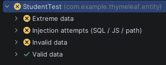
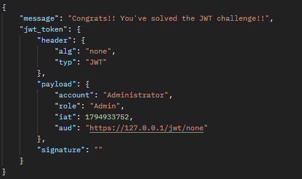
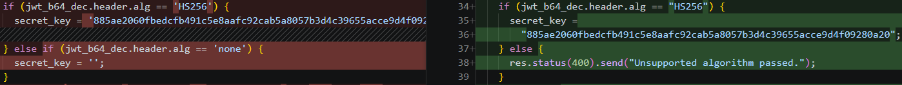
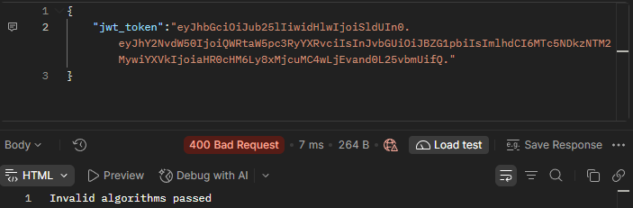

## Task 3 (Java)

### Zad 1

---

Stworzone testy znajdują się w pliku `src/test/java/com/example/thymeleaf/entity/StudentTest.java`. Pokrywają one testy poprawnych i niepoprawnych danych, próby wstrzyknięcia kodu SQL i JavaScript oraz wartości ekstremalnych. Testy poprawnych danych przechodzą, natomiast pozostałe testy kończą się niepowodzeniem (zgodnie z przewidywaniami).

Zmieniono również zawartość pliku Dockerfile. Aktulanie zamiast komendy `RUN mvn clean install -DskipTests` użyta została komenda: `RUN mvn -B clean package`. Gdy testy się nie powodzą, budowanie obrazu zostaje wstrzymane.

### Zad 2

---

Wygenerowany token: `eyJhbGciOiJub25lIiwidHlwIjoiSldUIn0.eyJhY2NvdW50IjoiQWRtaW5pc3RyYXRvciIsInJvbGUiOiJBZG1pbiIsImlhdCI6MTc5NDkzMzc1MiwiYXVkIjoiaHR0cHM6Ly8xMjcuMC4wLjEvand0L25vbmUifQ.`

Wynik:

Zaproponowana zmiana:

Wynik:

