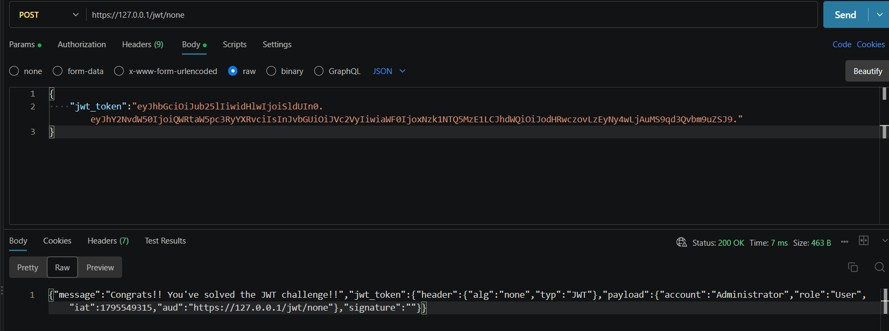
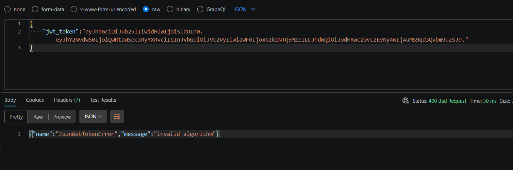

## Zadanie 1
Testy zostały dodane do aplikacji Python do obiektu Book oraz są odpalane przed zbudowaniem kontenera.
Testy nie przechodzą, więc kontener się nie buduje:
```
PS C:\Users\Mateusz\task3\Python\Flask_Book_Library> docker build -t flask-book-library .
[+] Building 9.2s (9/9) FINISHED                                                                                                                        docker:desktop-linux
 => [internal] load build definition from Dockerfile                                                                                                                    0.0s
 => => transferring dockerfile: 621B                                                                                                                                    0.0s
 => [internal] load metadata for docker.io/library/python:3.9-slim                                                                                                      0.9s
 => [internal] load .dockerignore                                                                                                                                       0.0s
 => => transferring context: 2B                                                                                                                                         0.0s
 => [1/5] FROM docker.io/library/python:3.9-slim@sha256:2d97f6910b16bd338d3060f261f53f144965f755599aab1acda1e13cf1731b1b                                                0.0s
 => => resolve docker.io/library/python:3.9-slim@sha256:2d97f6910b16bd338d3060f261f53f144965f755599aab1acda1e13cf1731b1b                                                0.0s
 => [internal] load build context                                                                                                                                       0.0s
 => => transferring context: 82.39kB                                                                                                                                    0.0s
 => CACHED [2/5] WORKDIR /app                                                                                                                                           0.0s
 => [3/5] COPY . .                                                                                                                                                      0.1s
 => [4/5] RUN pip install --no-cache-dir -r requirements.txt                                                                                                            7.3s
 => ERROR [5/5] RUN python -m unittest discover -s tests -v                                                                                                             0.8s 
------
 > [5/5] RUN python -m unittest discover -s tests -v:
0.665 test_accepts_all_supported_loan_periods (test_book.BookTests) ... ok
0.668 test_accepts_titles_at_length_boundaries (test_book.BookTests) ... ok
0.668 test_accepts_valid_data (test_book.BookTests) ... ok
0.668 test_rejects_extremely_long_title (test_book.BookTests) ... FAIL
0.674 test_rejects_incomplete_sql_fragment_as_title (test_book.BookTests) ... FAIL
0.675 test_rejects_inert_javascript_markup_as_title (test_book.BookTests) ... FAIL
0.675 test_rejects_missing_or_blank_title (test_book.BookTests) ... test_rejects_non_numeric_publication_year (test_book.BookTests) ... FAIL
0.676 test_rejects_title_just_over_length_limit (test_book.BookTests) ... FAIL
0.676 test_rejects_unsupported_loan_period (test_book.BookTests) ... FAIL
0.677 
0.677 ======================================================================
0.677 FAIL: test_rejects_extremely_long_title (test_book.BookTests)
0.677 ----------------------------------------------------------------------
0.677 Traceback (most recent call last):
0.677   File "/app/tests/test_book.py", line 71, in test_rejects_extremely_long_title
0.677     self.create_book(name="A" * 10_000_000)
0.677 AssertionError: ValueError not raised
0.677 
0.677 ======================================================================
0.677 FAIL: test_rejects_incomplete_sql_fragment_as_title (test_book.BookTests)
0.677 ----------------------------------------------------------------------
0.677 Traceback (most recent call last):
0.677   File "/app/tests/test_book.py", line 63, in test_rejects_incomplete_sql_fragment_as_title
0.677     self.create_book(name="' OR (")
0.677 AssertionError: ValueError not raised
0.677 
0.677 ======================================================================
0.677 FAIL: test_rejects_inert_javascript_markup_as_title (test_book.BookTests)
0.677 ----------------------------------------------------------------------
0.677 Traceback (most recent call last):
0.677   File "/app/tests/test_book.py", line 67, in test_rejects_inert_javascript_markup_as_title
0.677     self.create_book(name='<script type="text/plain">void 0</script>')
0.677 AssertionError: ValueError not raised
0.677 
0.677 ======================================================================
0.677 FAIL: test_rejects_missing_or_blank_title (test_book.BookTests) (title=None)
0.677 ----------------------------------------------------------------------
0.677 Traceback (most recent call last):
0.677   File "/app/tests/test_book.py", line 46, in test_rejects_missing_or_blank_title
0.677     self.create_book(name=title)
0.677 AssertionError: (<class 'TypeError'>, <class 'ValueError'>) not raised
0.677 
0.677 ======================================================================
0.677 FAIL: test_rejects_missing_or_blank_title (test_book.BookTests) (title='')
0.677 ----------------------------------------------------------------------
0.677 Traceback (most recent call last):
0.677   File "/app/tests/test_book.py", line 46, in test_rejects_missing_or_blank_title
0.677     self.create_book(name=title)
0.677 AssertionError: (<class 'TypeError'>, <class 'ValueError'>) not raised
0.677 
0.677 ======================================================================
0.678 FAIL: test_rejects_missing_or_blank_title (test_book.BookTests) (title='   ')
0.678 ----------------------------------------------------------------------
0.678 Traceback (most recent call last):
0.678   File "/app/tests/test_book.py", line 46, in test_rejects_missing_or_blank_title
0.678     self.create_book(name=title)
0.678 AssertionError: (<class 'TypeError'>, <class 'ValueError'>) not raised
0.678 
0.678 ======================================================================
0.678 FAIL: test_rejects_non_numeric_publication_year (test_book.BookTests)
0.678 ----------------------------------------------------------------------
0.678 Traceback (most recent call last):
0.678   File "/app/tests/test_book.py", line 54, in test_rejects_non_numeric_publication_year
0.678     self.create_book(year_published="nieznany")
0.678 AssertionError: (<class 'TypeError'>, <class 'ValueError'>) not raised
0.678 
0.678 ======================================================================
0.678 FAIL: test_rejects_title_just_over_length_limit (test_book.BookTests)
0.678 ----------------------------------------------------------------------
0.678 Traceback (most recent call last):
0.678   File "/app/tests/test_book.py", line 50, in test_rejects_title_just_over_length_limit
0.678     self.create_book(name="A" * 65)
0.678 AssertionError: ValueError not raised
0.678 
0.678 ======================================================================
0.678 FAIL: test_rejects_unsupported_loan_period (test_book.BookTests)
0.678 ----------------------------------------------------------------------
0.678 Traceback (most recent call last):
0.678   File "/app/tests/test_book.py", line 58, in test_rejects_unsupported_loan_period
0.678     self.create_book(book_type="30days")
0.678 AssertionError: ValueError not raised
0.678 
0.678 ----------------------------------------------------------------------
0.678 Ran 10 tests in 0.011s
0.678 
0.678 FAILED (failures=9)
------
```
## Zadanie 2


token: 
```
{
    "jwt_token":"eyJhbGciOiJub25lIiwidHlwIjoiSldUIn0.eyJhY2NvdW50IjoiQWRtaW5pc3RyYXRvciIsInJvbGUiOiJVc2VyIiwiaWF0IjoxNzk1NTQ5MzE1LCJhdWQiOiJodHRwczovLzEyNy4wLjAuMS9qd3Qvbm9uZSJ9."
}
```
Po usunięciu algorytmy none z listy odrzuca takie zapytania:



