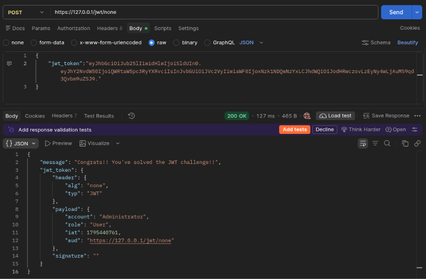

# Zadanie 1 – Rozszerzony zestaw testów jednostkowych

## Zakres wykonanych prac
Przygotowałem zestaw testów jednostkowych dla aplikacji w języku Python (`Flask_Book_Library`) z wykorzystaniem wbudowanego modułu `unittest`. Testowanym obiektem jest klasa `Book` z pliku `project/books/models.py`.

W projekcie wprowadzono następujące zmiany:
* utworzono katalog `tests/` z plikami `__init__.py` oraz `test_book.py` zawierającym 21 scenariuszy testowych,
* zmodyfikowano plik `Dockerfile`, dodając krok `RUN python -m unittest discover -s tests -v` po instalacji zależności, aby niepowodzenie testów automatycznie przerywało budowanie obrazu.

## Podsumowanie i wyniki testów

Łącznie uruchomiono **21 testów jednostkowych** – **3 testy przeszły pomyślnie (`ok`)**, a **18 zakończyło się niepowodzeniem (`FAIL`)**.

| Kategoria testów | Liczba testów | Przeszły (`ok`) | Nie przeszły (`FAIL`) | Zakres testowanych przypadków |
| :--- | :---: | :---: | :---: | :--- |
| Poprawne dane | 3 | 3 | 0 | Poprawne utworzenie obiektu, domyślny status `available`, reprezentacja tekstowa (`__repr__`) |
| Niepoprawne dane | 7 | 0 | 7 | Puste pola, wartości `None`, rok jako tekst, rok ujemny i z przyszłości, niepoprawny status, błędny typ `book_type` |
| Wstrzyknięcie kodu (SQLi i XSS) | 5 | 0 | 5 | 2 testy SQL Injection (`name`, `author`) oraz 3 testy XSS (`<script>`, ``, `<svg>` w polach `name`, `author`, `book_type`) |
| Testy ekstremalne | 4 | 0 | 4 | Bardzo długie ciągi znaków (10 000 znaków), ekstremalnie duży rok (`10**20`), znaki kontrolne i bajty zerowe (`\x00`) |
| Warunki brzegowe | 2 | 0 | 2 | Przekroczenie limitu kolumny `db.String(64)` (64 vs 65 znaków) oraz wartość graniczna roku `0` |
| **Razem** | **21** | **3** | **18** | |

## Wnioski i weryfikacja `docker build`
Wszystkie testy dla poprawnych danych zakończyły się sukcesem. Pozostałe 18 testów zwróciło `AssertionError` (brak oczekiwanego wyjątku `ValueError`/`TypeError`), ponieważ klasa `Book` w obecnej postaci nie posiada walidacji danych wejściowych i pozwala na utworzenie obiektu z błędnymi lub złośliwymi wartościami.

Podczas uruchomienia polecenia `docker build --progress=plain -t task3-python .` testy zostały automatycznie wykonane, a ich niepowodzenie zwróciło `exit code: 1`, przerywając budowanie obrazu zgodnie z założeniami zadania.

### Wyniki w terminalu

lista testów wraz ze statusem:


Komunikat o niepowodzeniu testów i przerwaniu budowania aplikacji:


# Zadanie 2 - JWT
Po otrzymaniu tokena Boba, skorzystałem ze strony jwt.io, która w łatwy sposób pozwala na manipulowanie zakodowanymi polami tokena. Screen ze strony:


Ostatecznie wygenerowałem token:
```
{   "jwt_token":"eyJhbGciOiJub25lIiwidHlwIjoiSldUIn0.eyJhY2NvdW50IjoiQWRtaW5pc3RyYXRvciIsInJvbGUiOiJVc2VyIiwiaWF0IjoxNzk1NDQwNzYxLCJhdWQiOiJodHRwczovLzEyNy4wLjAuMS9qd3Qvbm9uZSJ9."
}
```
Błędna weryfikacja podpisu umożliwiła przejęcie konta Administrator poprzez prostą edycję tokena Boba. W sekcji header ustawiono pole alg na 'none', w payload zmieniono wartość account na 'Administrator', a pole podpisu (signature) usunięto, pozostawiając jedynie kropkę na końcu tokena.
Screen z odpowiedzią:



### Dodanie poprawki
W linii 32 kodu app.js usunięto z listy algorytmów 'none', a także poprzedzający ją warunek (w razie algorytmu 'none' zwracano pusty secret_key). Po tych poprawkach nie jest już możliwe wysyłanie tokenu bez odpowiedniego podpisu. 

Zmodyfikowana linia kodu:
```
    JWT.verify(jwt_token, secret_key, { algorithms: ['HS256'], complete: true, audience: 'https://127.0.0.1/jwt/none' }, (err, decoded_token) => {

```

Odpowiedź po poprawce:


