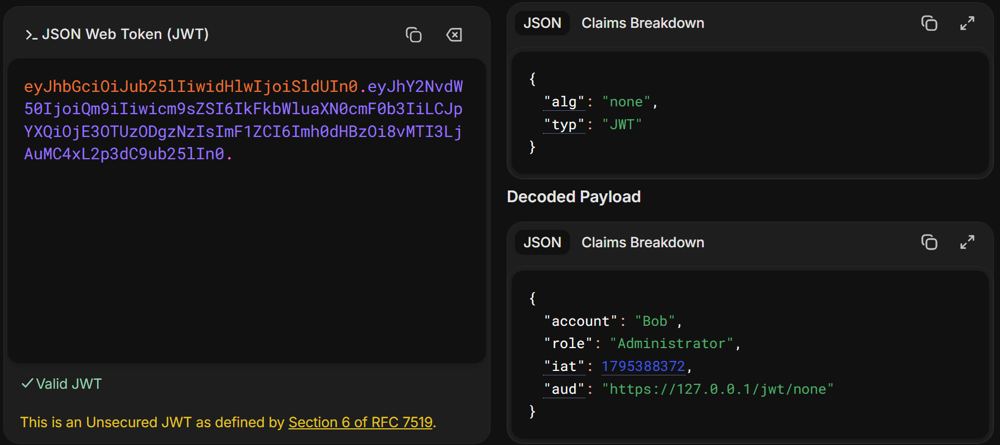
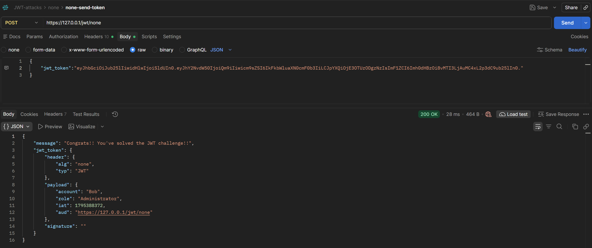
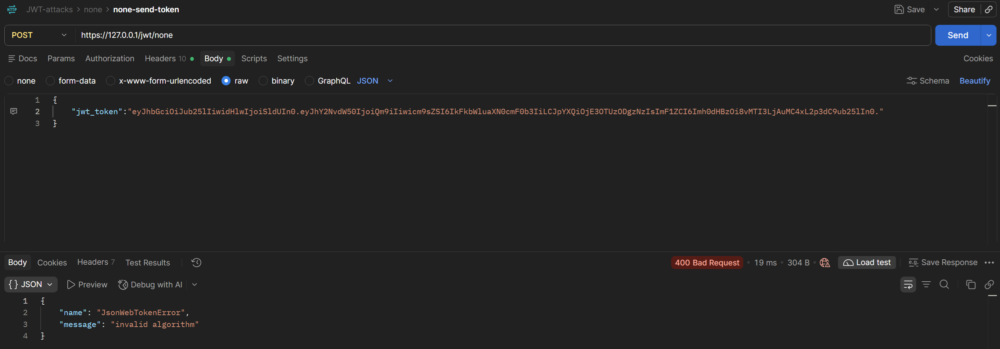

## Zadanie 1 - testy jednostkowe

- Przygotowałem rozszerzony zestaw testów jednostkowych dotyczących walidacji danych w klasie `CreateStudentDTO` w aplikacji Java
- Testy pokrywają wszystkie wymagane kategorie: poprawne dane, niepoprawne dane, próby SQL injection, próby XSS oraz przypadki ekstremalne
- Zmodyfikowałem `Dockerfile` tak, aby testy były uruchamiane przed zbudowaniem obrazu

## Zadanie 2 -JWT

- Zapoznałem się z budową tokena JWT oraz wykryłem w kodzie podatność polegającą na jawnej akceptacji braku podpisu (`alg: none`) dla endpointu `/jwt/none`
- Przygotowałem token JWT bez podpisu przy pomocy strony jwt.io, ustawiając w nim rolę na `Administrator` (mógłby to być problem, gdyby aplikacja autoryzowała dostęp na podstawie roli odczytanej z tokenu JWT)

  

- Wykorzystanie podatności: token bez podpisu został przez aplikację poprawnie zweryfikowany

  

- Usunięcie podatności polegało na wyłączeniu w kodzie akceptacji tokenów bez podpisu
- Po wprowadzeniu poprawki aplikacja zwraca `400 Bad Request` z informacją o niepoprawnym algorytmie

  
